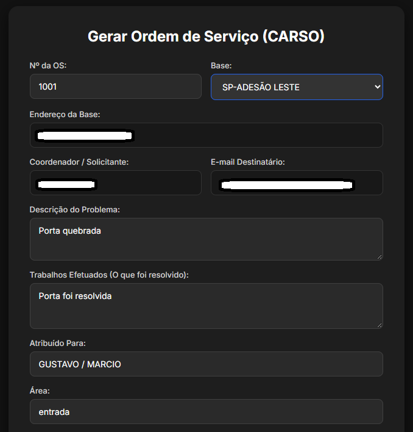

# ⚙️ Gerador Automatizado de Ordens de Serviço (VBA + Flask + Firebase)

Sistema integrado desenvolvido para otimizar e automatizar a geração de Ordens de Serviço (OS) em ambiente corporativo de infraestrutura de TI, eliminando retrabalho manual e centralizando os registros de atendimento.

---

## 🚀 Sobre o Projeto

Esta ferramenta faz a ponte entre o ecossistema desktop (Planilhas Excel com macros VBA e automação COM) e uma interface web moderna em Flask. Os dados de atendimento são processados, convertidos em relatórios padronizados e sincronizados em tempo real com o banco de dados em nuvem.

---

## 🛠️ Tecnologias Utilizadas

* **Python & Flask:** Servidor web local e lógica principal de backend.
* **VBA & Excel:** Automação de planilhas locais, geração de PDF e integração COM.
* **Firebase Realtime Database:** Armazenamento e sincronização em nuvem.
* **HTML5 / CSS3:** Interface web limpa e responsiva para operação interna.
* **Python-Dotenv:** Gerenciamento seguro de variáveis de ambiente e credenciais sensíveis.

---

## ⚙️ Funcionalidades Principais

* **Automação de OS:** Preenchimento de modelos e geração automática de arquivos de saída.
* **Sincronização em Nuvem:** Envio assíncrono de registros estruturados para o Firebase.
* **Segurança de Dados:** Isolamento completo de credenciais e dados confidenciais utilizando variáveis de ambiente (`.env`).
* **Interface Integrada:** Facilidade de uso para operadores e equipes de suporte de infraestrutura.

---

---

## 📸 Demonstração do Sistema

### 1. Interface de Preenchimento (Web)

### 2. Confirmação de Sucesso

### 3. Relatório em PDF Gerado
| Parte Superior | Parte Inferior |
| :---: | :---: |
|  |  |

### 4. Simulação de E-mail (Outlook)

## 🔒 Segurança e Privacidade

Para proteger dados confidenciais da empresa e chaves de acesso privadas, este repositório utiliza um arquivo `.gitignore` rigoroso que bloqueia o envio de:
* Arquivos de configuração local (`.env`)
* Credenciais de API (`chave-firebase.json`)
* Planilhas reais de trabalho contendo dados de clientes/colaboradores (`*.xlsm`)
